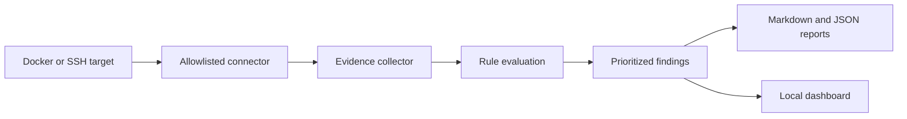

# PROJECT AXIOM

**Read-only Linux and container security audits, with evidence-backed findings and a SOC-style dashboard.**


AXIOM collects configuration evidence through a command allowlist, evaluates each check as **PASS**, **FAIL** or **UNKNOWN**, and produces a prioritized remediation list. A local browser dashboard presents the exported findings.

## What it checks

- SSH root login and password authentication settings.
- World-writable files in `/etc` and `/etc/shadow` permissions.
- Listening ports, passwordless sudo rules and empty-password accounts.
- Pending package upgrades through an APT simulation.

Checks depend on the target's Linux tools, permissions and configuration. These are configuration audits, not comprehensive CVE scans; missing evidence remains UNKNOWN.

## Architecture



## Quick start

Requires Python, the dependencies in `requirements.txt`, and access to a Docker target or an authorized SSH host. Docker mode needs a running Docker daemon; SSH mode needs credentials and a reachable Linux host.

```bash
git clone https://github.com/Sachin-MS-77/project-axiom.git
cd project-axiom
python3 -m venv .venv
source .venv/bin/activate
python -m pip install -r requirements.txt
python axiom.py --help
```

Audit an existing container you own:

```bash
python axiom.py --target YOUR_CONTAINER_NAME --method docker --output REPORT.md --json REPORT.json
```

Or use an SSH key:

```bash
python axiom.py --target YOUR_HOST --method ssh --username YOUR_USER --key-path /path/to/private-key --output REPORT.md --json REPORT.json
```

The report directory receives `report_data.js`. For the default output location, open `index.html` in a browser to view the dashboard; the CLI writes the Markdown report and optional JSON export alongside it.

## Repository guide

| File | Responsibility |
|---|---|
| `axiom.py` | CLI and audit pipeline |
| `connector.py` | Docker/SSH access and command allowlist enforcement |
| `collector.py` | Evidence collection |
| `rules.py` / `rule_engine.py` | Check definitions and verdict evaluation |
| `prioritizer.py` / `report.py` | Remediation ordering and report generation |
| `index.html` / `dashboard.js` / `styles.css` | Browser dashboard |
| `targets/` | Clean, partial and broken Docker target fixtures |
| `verify_no_drift.sh` | Repeated-run comparison utility |

Use only systems you own or are authorized to assess. Review findings before changing a target; AXIOM's audit pipeline does not apply remediation automatically. Fixture reports describe their specific targets and are not independent production validation.
